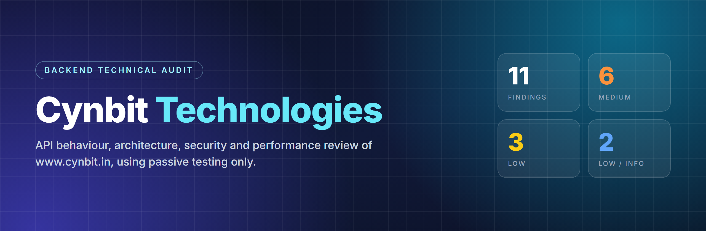
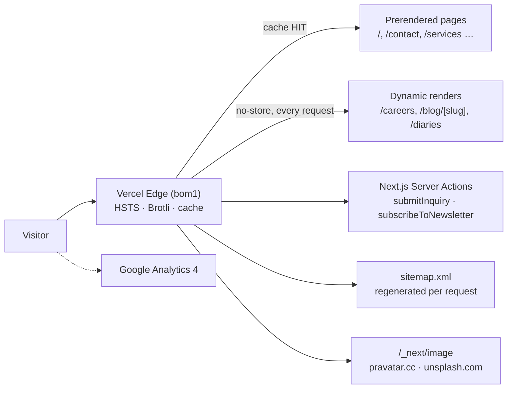

<p align="center">
  
</p>

<p align="center">
  
  
  
  
</p>

<p align="center">
  <a href="docs/BACKEND_AUDIT_REPORT.md"><b>📄 Read the full report</b></a>
  &nbsp;·&nbsp;
  <a href="docs/Cynbit_Backend_Audit_Report.pdf"><b>⬇️ Download PDF</b></a>
  &nbsp;·&nbsp;
  <a href="scripts/passive-checks.sh"><b>🔁 Re-run the checks</b></a>
</p>

---

## Overview

A backend-focused technical audit of Cynbit Technologies' public website. It covers:

- observable API behaviour, backend architecture and payloads
- security, performance, data validation, authentication and error handling
- concrete improvements, with working Next.js code examples

| | |
|---|---|
| **Prepared by** | Maloth Bhavsingh |
| **Role** | Backend Developer Intern (technical task) |
| **Target** | https://www.cynbit.in |
| **Observed on** | 31 October 2026 |

## Deliverables

| | Deliverable | What it covers | Link |
|---|---|---|---|
| 🏗️ | **Backend Technical Audit Report** | Hosting, rendering, routes, Server Action API surface, payloads, caching | [Section 3](docs/BACKEND_AUDIT_REPORT.md#3-backend-technical-audit-observed-architecture) |
| 🛡️ | **Security & Performance Findings** | 11 findings, each with evidence, impact and severity | [Section 4](docs/BACKEND_AUDIT_REPORT.md#4-security-and-performance-findings) |
| 🛠️ | **Recommended Improvements** | Code for headers, validation, rate limiting, ISR, auth, consent, DNS | [Sections 5–7](docs/BACKEND_AUDIT_REPORT.md#5-recommended-improvements-with-code) |
| 📕 | **PDF edition** | The full report, formatted for reading and printing | [PDF](docs/Cynbit_Backend_Audit_Report.pdf) |

## Observed architecture



## Findings at a glance

| # | Area | Finding | Severity |
|:-:|------|---------|:--------:|
| F1 | Security | No CSP, X-Frame-Options, X-Content-Type-Options, Referrer-Policy or Permissions-Policy headers | 🟠 Medium |
| F2 | Security / Data | Server Actions have no visible bot protection and no input length limits | 🟠 Medium |
| F3 | Error handling | Contact form has no `try/catch`, so a failed request leaves the button stuck loading | 🟠 Medium |
| F4 | Performance | `/careers`, `/blog/[slug]`, `/diaries` rendered on every request, ~3–4× slower than cached pages | 🟠 Medium |
| F5 | Performance / SEO | `sitemap.xml` regenerated per request with `lastmod` = current time | 🟡 Low |
| F6 | Architecture / SEO | Apex → www is a temporary `307`; sitemap and metadata use the apex; no canonical tag | 🟡 Low |
| F7 | Privacy / Compliance | Google Analytics loads before any consent | 🟠 Medium |
| F8 | Data / Dependencies | Third-party placeholder images proxied through the image optimiser | 🟡 Low |
| F9 | Email deliverability | SPF does not authorise Microsoft 365 (the MX); DMARC `p=none` without reports | 🟠 Medium |
| F10 | Security hygiene | `robots.txt` advertises `/admin/` and `/portal/`; no `security.txt` | 🔵 Low / Info |
| F11 | Transport | HSTS without `includeSubDomains`/`preload`; `Access-Control-Allow-Origin: *` on HTML | 🔵 Low / Info |

> Nothing observed exposes private data. Severity is relative to a public marketing site. The Medium items affect lead quality, contact-pipeline reliability, legal compliance and email deliverability.

### ✅ Already done well

HTTPS with HSTS · Brotli compression · immutable caching of hashed assets · correct `404` status codes · source maps not public · structured data and Open Graph tags · Server Actions protected by Next.js's built-in origin check.

## Recommended improvements

| Priority | Improvement | Fixes |
|:-:|---|:-:|
| **P0** | Zod validation, honeypot and rate limiting on both Server Actions | F2 |
| **P0** | `try/catch/finally` and typed `ActionResult` responses in the forms | F3 |
| **P0** | Security headers, with the CSP starting in Report-Only mode | F1 |
| **P0** | Fix SPF, enable DKIM, add DMARC reporting | F9 |
| **P1** | ISR and on-demand revalidation for content pages and the sitemap | F4, F5 |
| **P1** | Google Consent Mode v2 and a cookie banner | F7 |
| **P1** | One canonical host: `308` redirect, `metadataBase`, canonical tags | F6 |
| **P2** | Persist-then-notify lead pipeline, Turnstile, newsletter double opt-in | F2 |
| **P2** | Self-hosted images, enforced CSP, HSTS preload, `security.txt` | F8, F1, F11, F10 |

Every item has working code in [Section 5 of the report](docs/BACKEND_AUDIT_REPORT.md#5-recommended-improvements-with-code).

## Methodology

<table>
<tr>
<td width="50%" valign="top">

**✔️ Done (passive)**

- `GET` requests to public pages, the same requests a browser makes
- Reading response headers and public JS bundles
- Public DNS lookups (MX, SPF, DMARC)
- Time-to-first-byte, 3 runs per route

</td>
<td width="50%" valign="top">

**✖️ Not done**

- No form submissions or direct Server Action calls
- No requests to `/admin` or `/portal`
- No fuzzing, injection or load testing
- No authentication attempts

</td>
</tr>
</table>

In total this was roughly a hundred requests spread over several minutes, which is less than one visitor browsing the site.

## Repository structure

```text
.
├── README.md
├── docs/
│   ├── BACKEND_AUDIT_REPORT.md          # full report (renders on GitHub)
│   ├── Cynbit_Backend_Audit_Report.pdf  # PDF edition
│   └── assets/banner.png
└── scripts/
    └── passive-checks.sh                # reproduces the evidence
```

## Reproduce the evidence

```bash
bash scripts/passive-checks.sh
```

The script uses only `curl` and `nslookup`, and makes a small number of `GET` requests and DNS lookups.

---

<p align="center"><sub>Prepared by <b>Maloth Bhavsingh</b> for the Cynbit Technologies Backend Developer Intern task · October 2026</sub></p>
