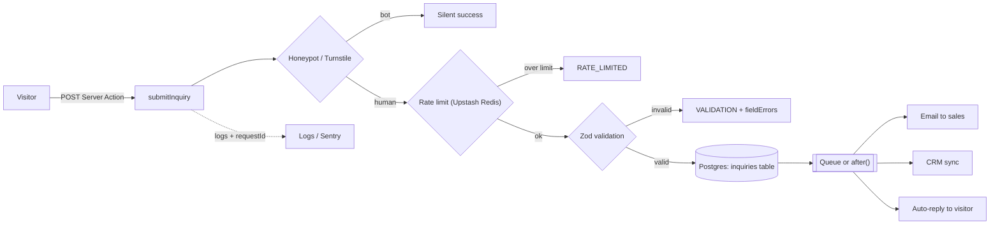

# Cynbit Technologies — Backend Technical Audit

**Target:** https://www.cynbit.in (public marketing site)  
**Role:** Backend Developer Intern — technical task  
**Author:** Maloth Bhavsingh  
**Date of observation:** 31 October 2026

---

## Contents

1. [Scope and method](#1-scope-and-method)
2. [Executive summary](#2-executive-summary)
3. [Backend technical audit: observed architecture](#3-backend-technical-audit-observed-architecture)
4. [Security and performance findings](#4-security-and-performance-findings)
5. [Recommended improvements, with code](#5-recommended-improvements-with-code)
6. [Proposed target architecture for lead capture](#6-proposed-target-architecture-for-lead-capture)
7. [Prioritised roadmap](#7-prioritised-roadmap)
8. [Appendix: evidence](#8-appendix-evidence)

---

## 1. Scope and method

### What I did (passive only)

- Loaded public pages with ordinary `GET` requests, the same requests a browser makes: `/`, `/contact`, `/careers`, `/blog/<slug>`, `/diaries`, `/impact`, `/navigation`, `/bitelevate/paths`, `/robots.txt`, `/sitemap.xml`, plus one made-up URL to see the 404 behaviour.
- Read the response headers (caching, security, redirects, compression).
- Read the public JavaScript bundles the site already sends to every visitor, to see how the forms talk to the server.
- Ran public DNS lookups (SPF, DMARC, MX), because the contact form's leads most likely end up as email.
- Timed time-to-first-byte (TTFB) three times per route.

In total this was roughly a hundred requests spread over several minutes. That is less than one visitor browsing the site.

### What I did not do

- I did **not submit** the contact form, the newsletter form or any other form, and did not call the server actions directly.
- I did **not request** `/admin/` or `/portal/` (both listed in `robots.txt`), and did not guess or fuzz any other paths.
- No load testing, no injection payloads, no attempt to authenticate.

### Limits

- Anything that happens inside the server (database, validation, email sending) cannot be seen from outside. Where a finding depends on server-side code I could not see, I say so and phrase it as "verify that…".
- Timings were measured from one location in India through a network proxy. They are good for comparing routes with each other, not as absolute numbers.

---

## 2. Executive summary

The site is a **Next.js (App Router) application hosted on Vercel**. The basics are solid: HTTPS everywhere with HSTS, Brotli compression, immutable caching of static assets, correct `404` status codes, and source maps not published.

The main opportunities are:

| # | Area | Finding | Severity |
|---|------|---------|----------|
| F1 | Security | No Content-Security-Policy, X-Frame-Options, X-Content-Type-Options, Referrer-Policy or Permissions-Policy headers | Medium |
| F2 | Security / Data | Contact and newsletter Server Actions have no visible bot protection (no CAPTCHA, no honeypot) and no input length limits | Medium |
| F3 | Error handling | Contact form client has no `try/catch`: a network or server error leaves the button stuck in its loading state | Medium |
| F4 | Performance | `/careers`, `/blog/[slug]` and `/diaries` are rendered on every request (`no-store`), ~3–4× slower than cached pages | Medium |
| F5 | Performance / SEO | `sitemap.xml` is regenerated on every request (~1 s) and stamps every URL with the current time as `lastmod` | Low |
| F6 | Architecture / SEO | Canonical host is inconsistent: site serves `www`, but sitemap, `og:url`, JSON-LD and robots point to the apex, which answers with a *temporary* `307` redirect; no `<link rel="canonical">` | Low |
| F7 | Privacy / Compliance | Google Analytics loads unconditionally; no consent mechanism observed | Medium |
| F8 | Data / Dependencies | Images proxied from third-party hosts (`i.pravatar.cc`, `images.unsplash.com`) through the Next.js image optimiser; pravatar images are random placeholder faces | Low |
| F9 | Email deliverability | SPF does not authorise Microsoft 365 although MX is Microsoft 365; DMARC is `p=none` with no reporting address | Medium |
| F10 | Security hygiene | `robots.txt` advertises `/admin/` and `/portal/`; no `/.well-known/security.txt` | Low / Info |
| F11 | Transport | HSTS lacks `includeSubDomains` / `preload`; HTML is sent with `Access-Control-Allow-Origin: *` | Low / Info |

Severity is relative to a marketing site: nothing I observed lets an attacker read private data. The medium items matter because they affect lead quality, availability of the contact pipeline, legal compliance, or whether Cynbit's own emails reach inboxes.

---

## 3. Backend technical audit: observed architecture

### 3.1 Hosting and edge

| Signal | Value | What it tells us |
|--------|-------|------------------|
| `Server` | `Vercel` | Hosted on Vercel |
| `X-Vercel-Id` | `bom1::…` | Served from Vercel's Mumbai edge region |
| `X-Vercel-Cache` | `HIT` / `MISS` | Edge cache is in use for prerendered routes |
| `X-Nextjs-Prerender: 1`, `X-Nextjs-Stale-Time: 300` | on `/` | Home page is statically prerendered |
| `X-Matched-Path` | `/`, `/blog/[slug]`, `/404` | Next.js App Router with dynamic segments |
| `/_next/static/chunks/app/(marketing)/…` | in HTML | A `(marketing)` route group with its own layout and template |

**Redirect chain**

```
http://cynbit.in      → 308 → https://cynbit.in
https://cynbit.in     → 307 → https://www.cynbit.in     (temporary!)
http://www.cynbit.in  → 308 → https://www.cynbit.in
```

So `https://www.cynbit.in` is the real origin, but the apex-to-www hop is marked *temporary*.

### 3.2 Routes discovered

From the HTML navigation and the 82-URL sitemap:

- **Static marketing pages:** `/`, `/story`, `/team`, `/services`, `/products`, `/case-studies`, `/impact`, `/contact`, `/navigation`, `/privacy`, `/terms`, `/cookies`
- **Content collections:** `/blog/[slug]`, `/careers/[slug]`, `/diaries/[slug]`, `/bitelevate`, `/bitelevate/paths`
- **Private areas (from `robots.txt` only, not visited):** `/admin/`, `/portal/`, `/api/`

`/api` and `/api/contact` return the site's normal `404`, so the forms do not use classic REST route handlers.

### 3.3 API surface: Next.js Server Actions

The forms post to **Server Actions**, which Next.js exposes as `POST` requests to the page URL with a `Next-Action` header carrying a hashed action ID. Two actions are referenced in the public bundles:

| Action name | Used by | Fields sent (`FormData`) |
|-------------|---------|--------------------------|
| `submitInquiry` | Contact form (`/contact`) | `fullName` (required), `email` (required, `type=email`), `company`, `industry`, `message` (required) |
| `subscribeToNewsletter` | Newsletter modal in the marketing layout | `email` |

Observed response contract (from how the client reads the result):

```ts
// submitInquiry
{ success: boolean }

// subscribeToNewsletter
{ success: boolean; message?: string; error?: string }
```

The two actions return **different shapes**, and `submitInquiry` returns no error detail at all, so the UI can only ever show one generic message.

The newsletter modal opens automatically 5 seconds after first visit and remembers that it has been shown with `localStorage.cynbit_newsletter_seen`.

### 3.4 Payloads and caching per route

| Route | Status | HTML size | `Cache-Control` | Edge cache | TTFB (3 runs) |
|-------|--------|-----------|-----------------|------------|---------------|
| `/` | 200 | 100 KB | `public, max-age=0, must-revalidate` | HIT | 0.21 / 0.19 / 0.18 s |
| `/contact` | 200 | 64 KB | `public, max-age=0, must-revalidate` | HIT | 0.56 / 0.17 / 0.18 s |
| `/careers` | 200 | 125 KB | `private, no-cache, no-store, …` | MISS | 0.52 / 0.69 / 0.58 s |
| `/blog/ai-agents-business-operations` | 200 | 91 KB | `private, no-cache, no-store, …` | MISS | 0.71 / 0.78 / 0.78 s |
| `/diaries` | 200 | 71 KB | `private, no-cache, no-store, …` | MISS | 0.52 / 1.17 / 0.58 s |
| `/sitemap.xml` | 200 | 14 KB | `public, max-age=0, must-revalidate` | MISS | 1.02 / 1.01 / 1.07 s |
| Unknown URL | **404** | 15 KB | `public, max-age=0, must-revalidate` | HIT | — |

Static assets under `/_next/static/` are served with `Cache-Control: public,max-age=31536000,immutable` and Brotli (`Content-Encoding: br`). The JavaScript chunks referenced by the home, contact and careers pages add up to about 720 KB before compression.

### 3.5 Third parties

| Host | Purpose |
|------|---------|
| `www.googletagmanager.com` | Google Analytics 4 (`G-LK6CQWCWX0`), preloaded in `<head>` |
| `fonts.googleapis.com` | Material Symbols icon font |
| `i.pravatar.cc` | Random avatar photos, proxied via `/_next/image` |
| `images.unsplash.com` | Stock photos, proxied via `/_next/image` |
| `www.transparenttextures.com` | Background texture image (hot-linked) |

### 3.6 Things that are already done well

- HTTPS enforced on both hosts, HSTS with a 2-year `max-age`.
- Brotli compression for HTML and JS.
- Content-hashed static assets with one-year immutable caching.
- Real `404` status for unknown pages and unknown blog slugs (no "soft 404s").
- Source maps are not public (`.js.map` returns `403`).
- Structured data (JSON-LD `ProfessionalService`) and Open Graph tags are present.
- Forms use Server Actions, which come with Next.js's built-in Origin/Host check against cross-site form posts.

---

## 4. Security and performance findings

Each finding lists: **evidence → impact → recommendation** (code in section 5).

### Security

#### F1 — Missing security headers · Medium

**Evidence.** The home page response has `Strict-Transport-Security` but none of: `Content-Security-Policy`, `X-Frame-Options` (or CSP `frame-ancestors`), `X-Content-Type-Options`, `Referrer-Policy`, `Permissions-Policy`.

**Impact.**
- Without `frame-ancestors`/`X-Frame-Options`, any site can embed cynbit.in in an iframe (clickjacking, e.g. on the contact form).
- Without a CSP, any future XSS bug (in a blog post, a dependency, a CMS field) has no second line of defence.
- Without `nosniff`, browsers may guess content types.

**Recommendation.** Add a header set in `next.config.ts`, starting the CSP in `Report-Only` mode so nothing breaks. → [§5.1](#51-security-headers-f1-f11)

#### F2 — No bot protection or length limits on Server Actions · Medium

**Evidence.**
- No CAPTCHA library (reCAPTCHA, hCaptcha, Turnstile) and no honeypot field appear in the page or its bundles.
- The `<input>` and `<textarea>` elements have no `maxLength`.
- `required` and `type="email"` exist only in the browser; anyone can call the action without them.

**Impact.** A Server Action is a public `POST` endpoint. A script can fill the inquiry inbox or newsletter list with spam, send very large messages, or use the newsletter to sign up third-party email addresses. If each submission triggers an email, it can also burn the email provider's quota and hurt the sending domain's reputation.

**What I could not see.** Whether the server validates or rate-limits already. Please treat this as "verify, and add if missing".

**Recommendation.** Validate with a schema on the server, add a honeypot and Cloudflare Turnstile, rate-limit per IP, and cap field lengths on both sides. → [§5.2](#52-hardened-server-action-f2-f3)

#### F7 — Analytics loads before consent · Medium

**Evidence.** The GA4 script is preloaded in `<head>` and configured on every page. The bundle code matches the `@next/third-parties` `GoogleAnalytics` component. No cookie or consent banner is present in the served HTML, although a `/cookies` policy page exists.

**Impact.** GA sets identifiers in the visitor's browser. India's Digital Personal Data Protection Act 2023 is consent-based, and visitors from the EU/UK fall under GDPR/ePrivacy, which require consent before non-essential cookies.

**Recommendation.** Use Google Consent Mode v2 with everything denied by default, and grant only after the visitor accepts. → [§5.6](#56-consent-gated-analytics-f7)

#### F10 — `robots.txt` lists private paths; no `security.txt` · Low / Info

**Evidence.** `robots.txt` contains `Disallow: /admin/` and `Disallow: /portal/`. `/.well-known/security.txt` returns `404`.

**Impact.** `robots.txt` is a public file, so it tells anyone where the admin area is. That is fine **only if** those areas are properly protected. `robots.txt` is not access control. Without `security.txt`, a researcher who finds a problem has no official contact to report it to.

**Recommendation.** Make sure every admin/portal route and every Server Action used there checks the session **on the server**, not only in middleware. Add a `security.txt`. → [§5.7](#57-protecting-admin-and-portal-f10)

#### F11 — HSTS and CORS details · Low / Info

**Evidence.** `Strict-Transport-Security: max-age=63072000` (no `includeSubDomains`, no `preload`). HTML responses carry `Access-Control-Allow-Origin: *`.

**Impact.** Subdomains are not covered by HSTS. The wildcard CORS header on public HTML does not leak anything today (no cookies are involved), but it is wider than needed and would become risky if a JSON endpoint later inherited it.

**Recommendation.** Once every `*.cynbit.in` subdomain is confirmed to be HTTPS-only, add `includeSubDomains; preload`. Leave CORS headers off by default and add them only to routes that need them. → [§5.1](#51-security-headers-f1-f11)

### Data handling and error handling

#### F3 — Contact form can get stuck on errors · Medium

**Evidence.** The contact form handler, de-minified from the public bundle, is:

```js
const onSubmit = async (e) => {
  e.preventDefault();
  setLoading(true);
  setError(null);
  const result = await submitInquiry(new FormData(e.currentTarget)); // no try/catch
  setLoading(false);
  result.success ? setSent(true) : setError("Something went wrong. Please try again or email us directly.");
};
```

**Impact.** If the action throws (network drop, function timeout, deploy in progress, unhandled server exception), `setLoading(false)` never runs. The visitor sees a spinner forever, and the lead is lost without anyone knowing. The `{ success }` response also has no error code, so the UI cannot say what went wrong (for example "email looks invalid").

**Recommendation.** Wrap the call in `try/catch/finally`, return a typed result with field errors, and give both actions the same response contract. → [§5.2](#52-hardened-server-action-f2-f3)

#### F8 — Third-party images through the optimiser · Low

**Evidence.** `/_next/image?url=https%3A%2F%2Fi.pravatar.cc%2F100%3Fimg%3D21` (and similar), plus `images.unsplash.com` photos.

**Impact.**
- Every unique remote image is fetched and resized by Cynbit's Vercel image optimiser, which counts against the plan's image quota.
- If pravatar or Unsplash are slow or down, those parts of the page break.
- pravatar.cc returns random stock faces. Showing them next to "users" or testimonials can look like fake social proof to a technical visitor.

**Recommendation.** Self-host the images you keep, drop the placeholder avatars, and restrict `images.remotePatterns` to exact hosts and paths. → [§5.1](#51-security-headers-f1-f11)

#### F9 — Email authentication (SPF/DMARC) · Medium

**Evidence (public DNS):**

```
MX     cynbit.in → cynbit-in.mail.protection.outlook.com   (Microsoft 365)
TXT    cynbit.in → "v=spf1 include:secureserver.net -all"   (GoDaddy only)
TXT    _dmarc.cynbit.in → "v=DMARC1; p=none;"
```

**Impact.** Mail is hosted on Microsoft 365, but SPF only authorises GoDaddy's servers and ends in a hard fail (`-all`). Mail sent through Microsoft 365 (or a transactional provider used by the contact form) therefore fails SPF, and passes DMARC only if DKIM is correctly set up. A public lookup did not find the standard Microsoft 365 DKIM selector. DMARC `p=none` without `rua=` means nobody receives reports, so spoofing of `@cynbit.in` is neither blocked nor seen.

**Recommendation.** Fix the SPF include, enable DKIM, and add DMARC reporting before tightening the policy. → [§5.8](#58-email-dns-f9)

### Performance and architecture

#### F4 — Content pages are rendered on every request · Medium

**Evidence.** `/careers`, `/blog/[slug]` and `/diaries` return `Cache-Control: private, no-cache, no-store` and are always `X-Vercel-Cache: MISS`. TTFB is 0.5–1.2 s compared with ~0.18 s for the cached pages (§3.4).

**Impact.** These pages change only when someone publishes a post or a job, but every visitor pays for a full server render. That is slower for users (and for Core Web Vitals / SEO), costs more serverless execution time, and gives a traffic spike nothing to fall back on.

**Likely cause.** Something in these routes opts into dynamic rendering, for example reading `cookies()`, `headers()` or `searchParams`, a `fetch(..., { cache: "no-store" })`, or `export const dynamic = "force-dynamic"`. `next build` prints which routes are `ƒ (Dynamic)`.

**Recommendation.** Render them statically with Incremental Static Regeneration (ISR) and revalidate on publish. → [§5.3](#53-static-rendering-with-isr-f4)

#### F5 — Sitemap is dynamic and its `lastmod` is always "now" · Low

**Evidence.** Two requests about 90 seconds apart returned `lastmod` values of `2026-10-31T14:25:57.532Z` and `2026-10-31T14:27:22.941Z` for every URL. The route is always a cache `MISS` and takes about 1 s.

**Impact.** Google ignores `lastmod` when it is clearly unreliable, so the sitemap stops helping new posts get crawled quickly. Every crawler request also costs a server render.

**Recommendation.** Use each item's real update date and let the sitemap be cached. → [§5.4](#54-sitemap-robots-and-canonical-host-f5-f6)

#### F6 — Inconsistent canonical host · Low

**Evidence.**
- The site is served from `www.cynbit.in`.
- The sitemap (`<loc>https://cynbit.in/...`), `og:url`, `og:image`, JSON-LD `@id`/`url`, and the `Sitemap:` line in `robots.txt` all use `https://cynbit.in`.
- That host answers with `307 Temporary Redirect`.
- There is no `<link rel="canonical">` on the page.

Smaller related issues:
- The page title repeats the brand: `… Jaipur | Cynbit Technologies | Cynbit Technologies`. This is a title-template issue.
- `og:image` is an SVG, which most social networks (LinkedIn, X, Facebook, WhatsApp) do not render in link previews.
- `Crawl-delay` is ignored by Google.

**Impact.** All 82 sitemap URLs are redirects, and a *temporary* redirect tells search engines the apex might come back. Link equity and analytics are split between two hosts.

**Recommendation.** Pick `www` as the single canonical host. Make the apex redirect permanent (`308`), and generate every absolute URL from a single `metadataBase`. → [§5.4](#54-sitemap-robots-and-canonical-host-f5-f6)

#### Additional observation — Content hidden until JavaScript runs

The contact `<form>` is server-rendered with `style="opacity:0"` and faded in by an animation library after hydration. On slow devices, or if a script fails, the form stays invisible even though the HTML has already arrived. Prefer CSS-only entrance animations, or start from `opacity: 1` and animate from a small offset instead.

---

## 5. Recommended improvements, with code

The snippets target **Next.js 15 (App Router) + TypeScript**, matching what the site runs on. Names such as `saveInquiry` and `notifyTeam` are placeholders for Cynbit's own database and email code.

### 5.1 Security headers (F1, F11)

```ts
// next.config.ts
import type { NextConfig } from "next";

// Start in Report-Only mode, watch the browser console / report endpoint for a
// week, then rename the header to "Content-Security-Policy".
const csp = [
  "default-src 'self'",
  "script-src 'self' 'unsafe-inline' https://www.googletagmanager.com",
  "style-src 'self' 'unsafe-inline' https://fonts.googleapis.com",
  "font-src 'self' https://fonts.gstatic.com",
  "img-src 'self' data: blob: https://www.google-analytics.com https://www.googletagmanager.com",
  "connect-src 'self' https://*.google-analytics.com https://*.analytics.google.com https://www.googletagmanager.com",
  "frame-src https://challenges.cloudflare.com", // Turnstile widget (see 5.2)
  "frame-ancestors 'none'",
  "base-uri 'self'",
  "form-action 'self'",
  "object-src 'none'",
].join("; ");

const securityHeaders = [
  { key: "Content-Security-Policy-Report-Only", value: csp },
  // Vercel already sends HSTS (max-age=63072000). Setting it here replaces that default, so only
  // add this line once every subdomain is confirmed HTTPS-only:
  // { key: "Strict-Transport-Security", value: "max-age=63072000; includeSubDomains; preload" },
  { key: "X-Frame-Options", value: "DENY" }, // for older browsers; CSP frame-ancestors covers modern ones
  { key: "X-Content-Type-Options", value: "nosniff" },
  { key: "Referrer-Policy", value: "strict-origin-when-cross-origin" },
  { key: "Permissions-Policy", value: "camera=(), microphone=(), geolocation=(), payment=()" },
];

const nextConfig: NextConfig = {
  async headers() {
    return [{ source: "/:path*", headers: securityHeaders }];
  },
  images: {
    // Only exact hosts and paths. Self-host what you can and remove i.pravatar.cc.
    remotePatterns: [{ protocol: "https", hostname: "images.unsplash.com", pathname: "/photo-*" }],
  },
};

export default nextConfig;
```

Notes:

- `'unsafe-inline'` for scripts is needed because Next.js injects inline bootstrap scripts. Removing it requires per-request nonces set in middleware, which makes every page dynamic. For a marketing site, the policy above plus `frame-ancestors`/`object-src`/`base-uri` already gives most of the benefit.
- When you enable Turnstile (5.2), also add `https://challenges.cloudflare.com` to `script-src`.
- Mailbox names used in this report (`security@`, `dmarc-reports@`) are suggestions; use whichever inboxes Cynbit monitors.
- Self-host the `transparenttextures.com` background instead of adding it to `img-src`.
- The `Access-Control-Allow-Origin: *` on HTML comes from the hosting layer. If it is set in `vercel.json` or `next.config.ts`, remove it there. Otherwise it is harmless for public HTML; just never copy it onto JSON endpoints.

### 5.2 Hardened Server Action (F2, F3)

**Shared result type**, so both actions answer the same way:

```ts
// lib/action-result.ts
export type ActionResult =
  | { success: true; message?: string }
  | {
      success: false;
      code: "VALIDATION" | "RATE_LIMITED" | "BOT" | "SERVER";
      error: string;
      fieldErrors?: Partial<Record<string, string[]>>;
    };
```

**Server Action** with schema validation, honeypot, Turnstile, rate limiting and persist-before-notify:

```ts
// app/(marketing)/contact/actions.ts
"use server";

import { z } from "zod";
import { headers } from "next/headers";
import { Ratelimit } from "@upstash/ratelimit";
import { Redis } from "@upstash/redis";
import type { ActionResult } from "@/lib/action-result";
import { saveInquiry, notifyTeam } from "@/lib/inquiries"; // Cynbit's own DB + email code

const InquirySchema = z.object({
  fullName: z.string().trim().min(2, "Please enter your name").max(100),
  email: z.string().trim().toLowerCase().email("Please enter a valid email").max(254),
  company: z.string().trim().max(120).optional(),
  industry: z.string().trim().max(80).optional(),
  message: z.string().trim().min(10, "Please tell us a little more").max(5000),
});

// 5 inquiries per IP per 10 minutes.
const ratelimit = new Ratelimit({
  redis: Redis.fromEnv(),
  limiter: Ratelimit.slidingWindow(5, "10 m"),
  prefix: "rl:inquiry",
});

async function verifyTurnstile(token: string, ip: string): Promise<boolean> {
  const res = await fetch("https://challenges.cloudflare.com/turnstile/v0/siteverify", {
    method: "POST",
    body: new URLSearchParams({
      secret: process.env.TURNSTILE_SECRET_KEY!,
      response: token,
      remoteip: ip,
    }),
  });
  const data = (await res.json()) as { success: boolean };
  return data.success;
}

export async function submitInquiry(formData: FormData): Promise<ActionResult> {
  const requestId = crypto.randomUUID();
  const h = await headers();
  const ip = h.get("x-forwarded-for")?.split(",")[0]?.trim() ?? "unknown";

  // 1. Honeypot: a hidden "website" field that humans never fill.
  //    Pretend success so bots don't learn they were caught.
  if (formData.get("website")) return { success: true };

  // 2. Rate limit before doing any expensive work.
  const { success: withinLimit } = await ratelimit.limit(ip);
  if (!withinLimit) {
    return { success: false, code: "RATE_LIMITED", error: "Too many requests. Please try again in a few minutes." };
  }

  // 3. Bot check.
  const token = formData.get("cf-turnstile-response");
  if (typeof token !== "string" || !(await verifyTurnstile(token, ip))) {
    return { success: false, code: "BOT", error: "Please complete the verification and try again." };
  }

  // 4. Validate. Never trust the browser's `required` / `type="email"`.
  const parsed = InquirySchema.safeParse({
    fullName: formData.get("fullName") ?? undefined,
    email: formData.get("email") ?? undefined,
    company: formData.get("company") || undefined,
    industry: formData.get("industry") || undefined,
    message: formData.get("message") ?? undefined,
  });
  if (!parsed.success) {
    return {
      success: false,
      code: "VALIDATION",
      error: "Please check the highlighted fields.",
      fieldErrors: parsed.error.flatten().fieldErrors,
    };
  }

  try {
    // 5. Persist first, so a lead is never lost because email sending failed.
    const inquiry = await saveInquiry({ ...parsed.data, ip, requestId });

    // 6. Notify afterwards. A failure here is logged, not shown to the visitor.
    notifyTeam(inquiry).catch((err) =>
      console.error(JSON.stringify({ level: "error", event: "inquiry.notify_failed", requestId, err: String(err) })),
    );

    return { success: true, message: "Thanks! We'll be in touch soon." };
  } catch (err) {
    console.error(JSON.stringify({ level: "error", event: "inquiry.save_failed", requestId, err: String(err) }));
    return { success: false, code: "SERVER", error: "Something went wrong on our side. Please try again or email us directly." };
  }
}
```

On Vercel, a promise that keeps running after the response is sent can be cut off when the function freezes. Use `after()` from `next/server` (Next.js 15) or Vercel's `waitUntil()` for step 6, or better, push it onto a queue (see §6).

Apply the same pattern to `subscribeToNewsletter`, and add **double opt-in** (send a confirmation link and only add the address once it is clicked). This stops people signing up addresses that aren't theirs.

**Client form** with failure handling, length limits and field errors:

```tsx
// app/(marketing)/contact/ContactForm.tsx
"use client";

import { useState } from "react";
import { submitInquiry } from "./actions";
import type { ActionResult } from "@/lib/action-result";

export function ContactForm() {
  const [pending, setPending] = useState(false);
  const [result, setResult] = useState<ActionResult | null>(null);

  async function onSubmit(e: React.FormEvent<HTMLFormElement>) {
    e.preventDefault();
    setPending(true);
    setResult(null);
    try {
      setResult(await submitInquiry(new FormData(e.currentTarget)));
    } catch {
      // Network failure, timeout or an unhandled server error.
      setResult({ success: false, code: "SERVER", error: "We couldn't reach the server. Please try again." });
    } finally {
      setPending(false); // always runs, so the button can't stay stuck
    }
  }

  const fieldError = (name: string) =>
    result && !result.success ? result.fieldErrors?.[name]?.[0] : undefined;

  if (result?.success) return <p role="status">{result.message ?? "Thanks, we'll be in touch."}</p>;

  return (
    <form onSubmit={onSubmit}>
      <label htmlFor="fullName">Full name</label>
      <input id="fullName" name="fullName" required maxLength={100} autoComplete="name" />
      {fieldError("fullName") && <p role="alert">{fieldError("fullName")}</p>}

      <label htmlFor="email">Email</label>
      <input id="email" name="email" type="email" required maxLength={254} autoComplete="email" />
      {fieldError("email") && <p role="alert">{fieldError("email")}</p>}

      <label htmlFor="company">Company</label>
      <input id="company" name="company" maxLength={120} autoComplete="organization" />

      <label htmlFor="industry">Industry</label>
      <input id="industry" name="industry" maxLength={80} />

      <label htmlFor="message">Message</label>
      <textarea id="message" name="message" required minLength={10} maxLength={5000} rows={5} />
      {fieldError("message") && <p role="alert">{fieldError("message")}</p>}

      {/* Honeypot: hidden from people and screen readers, tempting for bots */}
      <input type="text" name="website" tabIndex={-1} autoComplete="off" aria-hidden="true"
             style={{ position: "absolute", left: "-10000px" }} />

      {/* Cloudflare Turnstile widget. Load its script once, e.g. in the page:
          <Script src="https://challenges.cloudflare.com/turnstile/v0/api.js" async defer />
          It adds a hidden cf-turnstile-response field to this form. */}
      <div className="cf-turnstile" data-sitekey={process.env.NEXT_PUBLIC_TURNSTILE_SITE_KEY} />

      {result && !result.success && <p role="alert">{result.error}</p>}
      <button type="submit" disabled={pending}>{pending ? "Sending…" : "Send message"}</button>
    </form>
  );
}
```

### 5.3 Static rendering with ISR (F4)

First find what makes the routes dynamic:

```bash
npx next build    # routes marked "ƒ (Dynamic)" are the ones rendered per request
```

Then remove that cause (for example move a `cookies()` read into a small client component) and make the route static with time-based plus on-demand revalidation:

```tsx
// app/(marketing)/blog/[slug]/page.tsx
import { notFound } from "next/navigation";
import { getAllPostSlugs, getPostBySlug } from "@/lib/content";

export const revalidate = 3600;    // re-render at most once an hour in the background
export const dynamicParams = true; // slugs published after the build are rendered on first visit, then cached

export async function generateStaticParams() {
  return (await getAllPostSlugs()).map((slug) => ({ slug }));
}

export default async function BlogPost({ params }: { params: Promise<{ slug: string }> }) {
  const { slug } = await params;
  const post = await getPostBySlug(slug);
  if (!post) notFound(); // keeps the correct 404 status
  return <article>{/* … */}</article>;
}
```

Apply the same `revalidate` to `/careers`, `/careers/[slug]`, `/diaries` and `/diaries/[slug]`.

**On-demand revalidation** so a new post or job is live immediately:

```ts
// app/api/revalidate/route.ts
import { revalidatePath } from "next/cache";
import { NextResponse, type NextRequest } from "next/server";
import { timingSafeEqual } from "node:crypto";

function isAuthorised(req: NextRequest): boolean {
  const given = Buffer.from(req.headers.get("x-revalidate-secret") ?? "");
  const expected = Buffer.from(process.env.REVALIDATE_SECRET ?? "");
  return expected.length > 0 && given.length === expected.length && timingSafeEqual(given, expected);
}

export async function POST(req: NextRequest) {
  if (!isAuthorised(req)) return NextResponse.json({ error: "Unauthorized" }, { status: 401 });

  const { path } = (await req.json()) as { path?: string };
  if (!path?.startsWith("/")) return NextResponse.json({ error: "Invalid path" }, { status: 400 });

  revalidatePath(path);
  revalidatePath("/sitemap.xml");
  return NextResponse.json({ revalidated: true, path });
}
```

The CMS or admin panel calls this endpoint after publishing. Expected result: TTFB for these pages drops from ~0.5–1.2 s to the ~0.2 s that cached pages already get.

### 5.4 Sitemap, robots and canonical host (F5, F6)

**One source of truth for the site URL:**

```ts
// lib/site.ts
export const SITE_URL = "https://www.cynbit.in";
```

```tsx
// app/layout.tsx (metadata excerpt)
import type { Metadata } from "next";
import { SITE_URL } from "@/lib/site";

export const metadata: Metadata = {
  metadataBase: new URL(SITE_URL),
  title: {
    default: "Cynbit Technologies | AI Automation & Software Solutions Jaipur",
    template: "%s | Cynbit Technologies", // page titles should NOT include the brand again
  },
  openGraph: { siteName: "Cynbit Technologies", images: ["/og-image.png"] }, // 1200×630 PNG, not SVG
};
```

Set the canonical per page, not in the root layout, otherwise every page would point to the home page:

```tsx
// app/(marketing)/careers/page.tsx
import type { Metadata } from "next";

export const metadata: Metadata = {
  title: "Careers", // rendered as "Careers | Cynbit Technologies" by the template
  alternates: { canonical: "/careers" },
  openGraph: { url: "/careers" },
};

// app/(marketing)/blog/[slug]/page.tsx (add to the file from 5.3)
import type { Metadata } from "next";

export async function generateMetadata({ params }: { params: Promise<{ slug: string }> }): Promise<Metadata> {
  const { slug } = await params;
  const post = await getPostBySlug(slug);
  return {
    title: post?.title,
    alternates: { canonical: `/blog/${slug}` },
    openGraph: { url: `/blog/${slug}` },
  };
}
```

With `metadataBase` set, these relative paths become `https://www.cynbit.in/...`.

**Sitemap** with real dates, cached:

```ts
// app/sitemap.ts
import type { MetadataRoute } from "next";
import { SITE_URL } from "@/lib/site";
import { getAllPosts, getAllJobs } from "@/lib/content";

export const revalidate = 86400; // regenerate at most daily (plus on-demand from 5.3)

export default async function sitemap(): Promise<MetadataRoute.Sitemap> {
  const [posts, jobs] = await Promise.all([getAllPosts(), getAllJobs()]);

  const staticPages = ["", "/story", "/team", "/services", "/products", "/case-studies", "/contact", "/careers"].map(
    (path) => ({ url: `${SITE_URL}${path}`, lastModified: new Date("2026-10-01") }), // date of last real change
  );

  return [
    ...staticPages,
    ...posts.map((p) => ({ url: `${SITE_URL}/blog/${p.slug}`, lastModified: p.updatedAt })),
    ...jobs.map((j) => ({ url: `${SITE_URL}/careers/${j.slug}`, lastModified: j.updatedAt })),
  ];
}
```

**robots** pointing at the canonical host:

```ts
// app/robots.ts
import type { MetadataRoute } from "next";
import { SITE_URL } from "@/lib/site";

export default function robots(): MetadataRoute.Robots {
  return {
    rules: { userAgent: "*", allow: "/", disallow: ["/api/"] },
    sitemap: `${SITE_URL}/sitemap.xml`,
  };
}
```

`/admin/` and `/portal/` are left out on purpose. Those pages should send `X-Robots-Tag: noindex` (or `robots: { index: false }` in their layout metadata) and sit behind authentication, so they don't need to be advertised.

**Permanent apex redirect.** In Vercel → Project → Settings → Domains, edit `cynbit.in` → "Redirect to `www.cynbit.in`" and choose **308 Permanent** instead of 307.

### 5.5 Images (F8)

- Move the photos actually used into `/public` (or a Cynbit-owned bucket) and serve them with `next/image` and explicit `sizes`.
- Replace pravatar placeholders with real, consented team or client photos, or with initials avatars rendered in CSS.
- Keep `remotePatterns` limited to exact hosts and paths (see 5.1). Never use a wildcard `hostname: "**"`, because that turns the image optimiser into an open proxy that anyone can make Cynbit pay for.

### 5.6 Consent-gated analytics (F7)

```tsx
// app/layout.tsx (excerpt)
import Script from "next/script";

const GA_ID = process.env.NEXT_PUBLIC_GA_ID; // G-LK6CQWCWX0

export default function RootLayout({ children }: { children: React.ReactNode }) {
  return (
    <html lang="en">
      <body>
        {children}

        {/* Consent Mode v2: everything denied until the visitor chooses */}
        <Script id="consent-default" strategy="beforeInteractive">{`
          window.dataLayer = window.dataLayer || [];
          function gtag(){dataLayer.push(arguments);}
          gtag('consent', 'default', {
            ad_storage: 'denied', ad_user_data: 'denied',
            ad_personalization: 'denied', analytics_storage: 'denied'
          });
        `}</Script>
        <Script src={`https://www.googletagmanager.com/gtag/js?id=${GA_ID}`} strategy="afterInteractive" />
        <Script id="ga-init" strategy="afterInteractive">{`
          gtag('js', new Date());
          gtag('config', '${GA_ID}');
        `}</Script>
      </body>
    </html>
  );
}
```

Remove the existing `<GoogleAnalytics />` component when adding this, so GA is not loaded twice.

```ts
// lib/consent.ts — called by the cookie banner's "Accept" button
declare global {
  interface Window { gtag?: (...args: unknown[]) => void }
}

export function grantAnalyticsConsent() {
  window.gtag?.("consent", "update", { analytics_storage: "granted" });
  document.cookie = "cynbit_consent=analytics; Max-Age=15552000; Path=/; SameSite=Lax; Secure";
}
```

On later visits, the banner reads `cynbit_consent` and calls `grantAnalyticsConsent()` again before showing anything. Put the consent banner in a small client component so the layout and pages stay static.

### 5.7 Protecting admin and portal (F10)

Middleware gives a fast redirect for visitors without a session cookie:

```ts
// middleware.ts
import { NextResponse, type NextRequest } from "next/server";

export function middleware(req: NextRequest) {
  if (!req.cookies.has("session")) {
    const login = new URL("/login", req.url);
    login.searchParams.set("next", req.nextUrl.pathname);
    return NextResponse.redirect(login);
  }
  return NextResponse.next();
}

export const config = { matcher: ["/admin/:path*", "/portal/:path*"] };
```

Middleware alone is **not** enough. It only checks that a cookie exists, and in March 2025 a Next.js vulnerability (CVE-2025-29927) let attackers skip middleware entirely on self-hosted apps. Vercel deployments were reported as not affected, but the lesson stands. Every admin page, route handler and Server Action must verify the session itself:

```ts
// lib/auth.ts
import "server-only";
import { cookies } from "next/headers";
import { verifySession } from "./session"; // validates signature + expiry, loads the user

export async function requireAdmin() {
  const token = (await cookies()).get("session")?.value;
  const user = token ? await verifySession(token) : null;
  if (!user || user.role !== "admin") throw new Error("Unauthorized");
  return user;
}

// app/admin/jobs/actions.ts
"use server";
import { requireAdmin } from "@/lib/auth";

export async function deleteJob(id: string) {
  await requireAdmin(); // first line of every admin action
  // …
}
```

Session cookies should be `HttpOnly; Secure; SameSite=Lax`, short-lived, and rotated on login.

**security.txt.** Create `public/.well-known/security.txt` (RFC 9116; `Contact` and `Expires` are required):

```
Contact: mailto:security@cynbit.in
Expires: 2027-10-31T00:00:00.000Z
Preferred-Languages: en, hi
Canonical: https://www.cynbit.in/.well-known/security.txt
```

### 5.8 Email DNS (F9)

```
; SPF: authorise Microsoft 365. Keep secureserver.net only if GoDaddy still sends
; mail for the domain, and add the contact-form email provider's include if it
; sends as @cynbit.in.
cynbit.in.        TXT  "v=spf1 include:spf.protection.outlook.com include:secureserver.net -all"

; DMARC: collect reports first, then tighten to quarantine, then reject.
_dmarc.cynbit.in. TXT  "v=DMARC1; p=none; rua=mailto:dmarc-reports@cynbit.in; fo=1"
; after 2–4 weeks of clean reports:
; _dmarc.cynbit.in. TXT "v=DMARC1; p=quarantine; pct=100; rua=mailto:dmarc-reports@cynbit.in"
```

Then enable DKIM for `cynbit.in` in the Microsoft 365 Defender portal, which creates the `selector1`/`selector2._domainkey` CNAME records.

---

## 6. Proposed target architecture for lead capture

Today the contact form most likely does validate → send email inside one request. If the email step fails, the lead may be lost and nobody notices. A more robust design:



Principles:

1. **Persist before side effects.** The database row is the source of truth. Email, CRM and Slack are retried from it.
2. **Idempotency.** Store a hash of `email + message + day` and ignore exact duplicates from double-clicks.
3. **One response contract** (`ActionResult`) for every action, with machine-readable `code`s.
4. **Observability.** Structured JSON logs with a `requestId`, error tracking (e.g. Sentry), and an uptime check that loads `/contact`.
5. **Data minimisation.** Keep the IP only for rate limiting and abuse review, and delete inquiries after a defined retention period, as the privacy policy should state.

Suggested table:

```sql
create table inquiries (
  id           uuid primary key default gen_random_uuid(),
  full_name    varchar(100)  not null,
  email        varchar(254)  not null,
  company      varchar(120),
  industry     varchar(80),
  message      varchar(5000) not null,
  source_ip    inet,
  request_id   uuid not null,
  dedupe_key   char(64) not null unique,          -- sha256(email|message|date)
  status       text not null default 'new'
               check (status in ('new','contacted','qualified','closed','spam')),
  notified_at  timestamptz,                       -- null = notification still pending/retry
  created_at   timestamptz not null default now()
);
create index inquiries_created_at_idx on inquiries (created_at desc);
create index inquiries_pending_notify_idx on inquiries (created_at) where notified_at is null;
```

---

## 7. Prioritised roadmap

| Priority | Item | Effort | Findings |
|----------|------|--------|----------|
| **P0 (this week)** | Server-side validation, honeypot, rate limit on both actions | ~1 day | F2 |
| | `try/catch/finally` and typed results in the forms | ~2 hours | F3 |
| | Security headers (CSP in Report-Only) | ~2 hours | F1 |
| | Fix SPF, enable DKIM, add DMARC `rua` | ~1 hour + DNS propagation | F9 |
| **P1 (next 2 weeks)** | ISR for careers, blog, diaries and the sitemap; on-demand revalidation | 1–2 days | F4, F5 |
| | Consent Mode v2 and cookie banner | ~1 day | F7 |
| | Canonical host: 308 redirect, `metadataBase`, canonical tags, PNG OG image, title template | ~half a day | F6 |
| **P2 (next month)** | Persist-then-notify pipeline, Turnstile, newsletter double opt-in | 2–3 days | F2, §6 |
| | Self-host images, tighten `remotePatterns` | ~half a day | F8 |
| | Enforce CSP; HSTS `includeSubDomains; preload` | after monitoring | F1, F11 |
| | `security.txt`, server-side auth checks audit for `/admin` and `/portal` | ~half a day | F10 |

**How to measure success**

- Cached TTFB (~0.2 s) on all content routes.
- Zero spam submissions reaching the inbox.
- 100% of inquiries persisted, even when email fails.
- DMARC reports showing aligned SPF/DKIM pass.
- securityheaders.com grade A.
- No "Duplicate without user-selected canonical" warnings in Search Console.

---

## 8. Appendix: evidence

All commands are plain `GET` requests or DNS lookups. They can be re-run to check the findings.

**Headers and redirects**

```bash
curl -sS -o /dev/null -D - https://www.cynbit.in/
curl -sS -o /dev/null -D - https://cynbit.in/            # 307 → www
curl -sS -o /dev/null -D - http://cynbit.in/             # 308 → https apex
```

Home page response (excerpt):

```
HTTP/1.1 200 OK
Access-Control-Allow-Origin: *
Cache-Control: public, max-age=0, must-revalidate
Server: Vercel
Strict-Transport-Security: max-age=63072000
X-Matched-Path: /
X-Nextjs-Prerender: 1
X-Nextjs-Stale-Time: 300
X-Vercel-Cache: HIT
X-Vercel-Id: bom1::…
```

**Caching per route**

```bash
for p in "" contact careers blog/ai-agents-business-operations diaries sitemap.xml; do
  curl -sS -o /dev/null -D - "https://www.cynbit.in/$p" | grep -iE '^(cache-control|x-vercel-cache):'
done
```

**Server Action references** in public bundles:

```
createServerReference("40247ba4…", callServer, void 0, findSourceMapURL, "submitInquiry")          // /contact page chunk
createServerReference("40cfc00a…", callServer, void 0, findSourceMapURL, "subscribeToNewsletter")  // (marketing) layout chunk
```

**Sitemap `lastmod` changing between requests**

```
14:25:57 run → <lastmod>2026-10-31T14:25:57.532Z</lastmod>
14:27:22 run → <lastmod>2026-10-31T14:27:22.941Z</lastmod>
```

**robots.txt**

```
User-agent: *
Allow: /
Sitemap: https://cynbit.in/sitemap.xml
Crawl-delay: 1
Disallow: /api/
Disallow: /admin/
Disallow: /portal/
```

**DNS**

```bash
nslookup -type=MX  cynbit.in          # cynbit-in.mail.protection.outlook.com
nslookup -type=TXT cynbit.in          # "v=spf1 include:secureserver.net -all"
nslookup -type=TXT _dmarc.cynbit.in   # "v=DMARC1; p=none;"
```

**Other checks**

```
/.well-known/security.txt                     → 404
/_next/static/chunks/webpack-….js.map         → 403 (source maps not public, good)
/_next/static/chunks/*.js                      → Cache-Control: public,max-age=31536000,immutable; Content-Encoding: br
/blog/no-such-post                             → 404 (correct status)
<link rel="canonical">                         → not present on /
```
